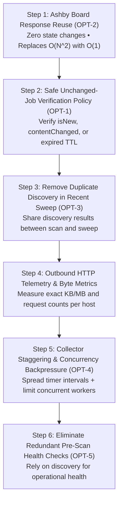

# RoleRadar — Network Consumption Optimization Master Plan

**Document Version:** 1.0.0  
**Status:** APPROVED FOR STAGED EXECUTION  
**Authoritative Reference:** `docs/NETWORK_OPTIMIZATION_MASTER_PLAN.md`  
**Related Audit:** `roleradar-network-consumption-forensic-audit.md`  

---

## 1. Executive Summary & Problem Statement

A forensic audit of the RoleRadar scanning, discovery, and verification subsystems identified that the Node.js backend's high internet data consumption is primarily driven by **unnecessary repeated verification and scheduling stampedes**, rather than source breadth.

On each 30-minute scan cycle across 156 ATS sources:
- Over **7,300 jobs** are discovered.
- **7,280+ individual live HTTP verification requests** are dispatched across the public internet.
- **Only ~69 jobs** are actually new or modified. 99% of verified jobs are existing, active, and unchanged.
- Ashby career sites re-download the **entire company job board JSON** for every single job candidate ($O(N^2)$ data transfer).
- Scheduled `setInterval` timers fire all 148+ active collectors at the exact same millisecond.
- Duplicate full-board discovery runs inside `runRecentSweep` on the same 30-minute interval.

---

## 2. Core Non-Negotiable Invariants

An unchanged job listing does not automatically prove that every verification requirement has been satisfied. The following architectural rules are non-negotiable and **must remain strictly preserved across all optimization steps**:

1. **Official-Source Confirmation:**  
   No job can enter `ACTIVE` status or receive `verification_status: 'VERIFIED'` without direct confirmation from the employer's authoritative ATS endpoint.
2. **Newly Discovered Job Verification:**  
   Every newly discovered job candidate (`isNew: true`) MUST undergo full live HTTP verification before admission.
3. **Materially Changed Job Verification:**  
   Any job whose title, location, description, or requirements change (`contentChanged: true`) MUST reset to `verification_status: 'PENDING'` and undergo complete re-verification.
4. **Job Closure and Removal Detection:**  
   The authoritative 100% complete scan absence reconciliation (`reconcileAbsentJobs`) and live HTTP 404 detection MUST continue to immediately transition removed jobs to `CLOSED`.
5. **Periodic Re-Verification (Continuous Freshness):**  
   Existing active jobs MUST NOT remain unverified indefinitely. Re-verification must occur at bounded, polite intervals (e.g. 12–24h TTL, coordinated through `ReverificationWorker`) to prevent stale or misleading ATS listings.
6. **Zero Silent Lowering of Standards:**  
   All seven verification checks (domain, existence, ID, title, location, status, apply URL) and composite scoring must remain identical.
7. **No Big-Bang Operations:**  
   Implementation must proceed in **controlled, isolated steps**, each backed by automated regression tests and empirical runtime evidence.

---

## 3. Five Confirmed Optimization Opportunities

| ID | Opportunity | Primary Affected Files | Expected Benefit |
| :--- | :--- | :--- | :--- |
| **OPT-1** | **Safe Unchanged-Job Verification Policy** | `pipeline.ts`, `job-service.ts` | **Very High (~99% reduction in live verification calls)** |
| **OPT-2** | **Ashby Board Response Reuse** | `ashby-collector.ts`, `verification-service.ts` | **Very High (Replaces $O(N^2)$ board downloads with $O(1)$)** |
| **OPT-3** | **De-duplicate Discovery in `runRecentSweep`** | `scheduler.ts`, `recent-source-sweep.ts` | **High (Eliminates 156 redundant discovery HTTP transfers)** |
| **OPT-4** | **Stagger Collectors & Request Backpressure** | `scheduler.ts`, `catalog.ts` | **High (Flattens 148-collector thundering herd spike)** |
| **OPT-5** | **Eliminate Redundant Pre-Scan Health Checks** | `scheduler.ts`, `base-collector.ts` | **Medium (Eliminates 156 duplicate pre-flight HTTP calls)** |

---

## 4. Controlled Staged Implementation Roadmap

---

### Step 1: Ashby Board Response Reuse (Priority: P0)
* **Objective:** Prevent `fetchAshbyJob` from re-downloading the entire company board JSON for each individual candidate.
* **Mechanism:**
  - In `AshbyCollector`, cache the raw parsed jobs array returned during `discoverJobs()` for the duration of the scan cycle (or pass an in-memory verification map into `runPipeline`).
  - `verification-service.ts` checks the provided in-memory board listing first. If present, it validates the candidate against the in-memory board data without issuing an outbound HTTP request.
  - If the cache/context is missing (e.g. ad-hoc single-job verification via admin), fall back to `fetchAshbyJob`.
* **Preservation Guardrail:** Matches title, externalJobId, and location against authoritative Ashby JSON data—zero reduction in verification accuracy.
* **Acceptance Criteria:**
  - For an Ashby employer with 30 jobs, total HTTP GET requests to `api.ashbyhq.com` drops from **31 requests to exactly 1 request**.
  - Regression tests in `ashby-collector.test.ts` pass.

---

### Step 2: Safe Unchanged-Job Verification Policy (Priority: P0)
* **Objective:** Eliminate redundant live HTTP requests for existing active jobs that were already verified and have not changed.
* **Mechanism:**
  - Inspect `{ isNew, contentChanged }` returned by `upsertDiscoveredJob(candidate, companyId)`.
  - Also inspect `last_verified_at` against a configurable Freshness TTL (e.g. `VERIFICATION_TTL_HOURS = 24`).
  - **Execute `verifyJob` ONLY IF:**
    1. `result.isNew === true` (brand new job candidate), OR
    2. `result.contentChanged === true` (title, location, description, or requirements changed), OR
    3. `existingJob.verification_status !== 'VERIFIED'` (failed or pending job needing recovery), OR
    4. `existingJob.last_verified_at` is older than `VERIFICATION_TTL_HOURS` (periodic safety check).
  - If the job is `ACTIVE + VERIFIED`, `contentChanged === false`, and within the TTL:
    - Simply update `last_seen_at = now()`.
    - Mark stats as `already_verified` (or `skipped`).
    - Do NOT call `markJobVerifying` and do NOT dispatch an external HTTP request.
* **Preservation Guardrails:**
  - New jobs are **always** verified.
  - Changed jobs are **always** re-verified.
  - Periodic background re-verification is maintained.
  - Absence reconciliation (`reconcileAbsentJobs`) continues to close jobs that disappear from the active board.
* **Acceptance Criteria:**
  - On a routine scan with 7,300 unchanged jobs, outbound verification requests drop from ~7,280 to < 100.
  - Newly added mock jobs and changed mock jobs still trigger verification.
  - Regression test suite passes with 100% green tests.

---

### Step 3: De-duplicate Discovery in Recent Source Sweep (Priority: P0)
* **Objective:** Prevent `runRecentSweep` from making an identical full ATS board HTTP download 3 seconds after `runScan`.
* **Mechanism:**
  - Modify `JobScheduler`: When `runScan` completes discovery for a collector, pass the discovered candidates directly into the recent-window filter (`filterCandidatesByRecentWindow`).
  - If recent qualifying candidates exist, evaluate alerts (`evaluateAndCreateInstantAlerts` with `discoveryReason: 'RECENT_JOB'`).
  - Remove the duplicate `setInterval` that called `collector.discoverJobs()` inside `runRecentSweep`.
* **Preservation Guardrail:** 100% of candidates within `config.recentJobWindowDays` are still evaluated and alerted; zero postings are missed.
* **Acceptance Criteria:**
  - Outbound discovery requests halved (from 2 per collector cycle to 1).
  - `RECENT_JOB` alert generation continues to function identically.

---

### Step 4: Outbound HTTP Telemetry & Byte Metrics (Priority: P1)
* **Objective:** Provide empirical proof of bandwidth reduction and ongoing observability.
* **Mechanism:**
  - Create a lightweight `tracedFetch` wrapper for outbound ATS requests.
  - Records: `host`, `method`, `status`, `durationMs`, `requestBytes` (headers + payload), `responseBytes` (headers + `content-length` or body length).
  - Expose summary stats via an internal admin telemetry query (e.g. total MB transferred per ATS host in the last hour).
* **Acceptance Criteria:**
  - Every outbound fetch records byte metrics.
  - Zero performance degradation on HTTP throughput.

---

### Step 5: Collector Staggering & Concurrency Backpressure (Priority: P1)
* **Objective:** Eliminate the 148-collector thundering herd stampede at the 30-minute interval mark.
* **Mechanism:**
  - Introduce deterministic startup offset jitter (e.g. spreading 156 collectors across the 30-minute window so ~5 collectors fire per minute).
  - Introduce an in-memory concurrency semaphore/queue (e.g. maximum 5 concurrent active collector scans).
* **Preservation Guardrail:** Every collector still runs at its configured interval; no collector is starved or skipped.
* **Acceptance Criteria:**
  - `scan_runs.started_at` timestamps are smoothly distributed over time rather than clustered within 28ms.
  - CPU spikes and socket exhaustion eliminated.

---

### Step 6: Eliminate Redundant Pre-Scan Health Checks (Priority: P1)
* **Objective:** Remove unnecessary pre-flight HTTP round-trips.
* **Mechanism:**
  - Since `discoverJobs()` inherently exercises the external API, use the outcome of discovery to update `sourceHealthTracker`.
  - Reserve standalone `healthCheck()` for manual admin health endpoints and system startup diagnostics.
* **Acceptance Criteria:**
  - Saves 156 HTTP calls per scan cycle.
  - `source_health` reporting remains 100% accurate.

---

## 5. Verification & Acceptance Protocol per Step

For each step executed:
1. **Pre-Implementation Baseline:** Run test suite and record request metrics.
2. **Implementation:** Apply surgical edits to designated files only.
3. **Automated Testing:** Run `npm test` across unit and integration tests.
4. **Empirical Validation:** Verify that expected network calls are eliminated while all invariant assertions pass.
5. **Documentation & Sign-off:** Log outcome in audit notes before moving to the next step.

