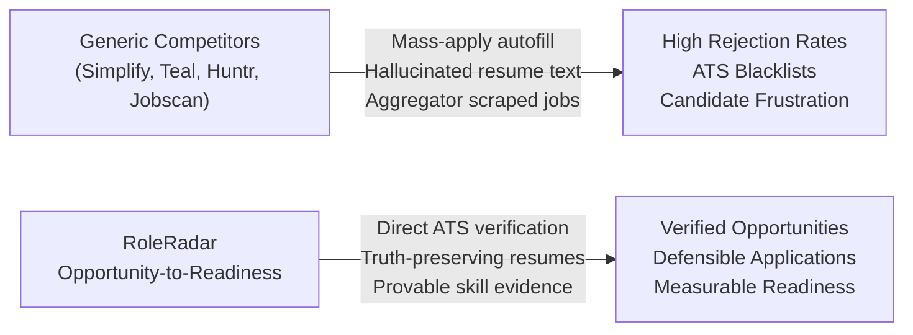
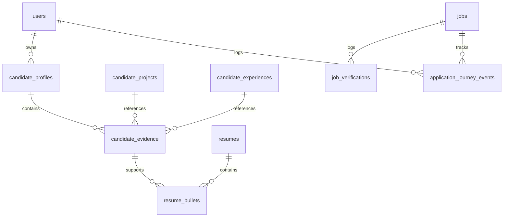
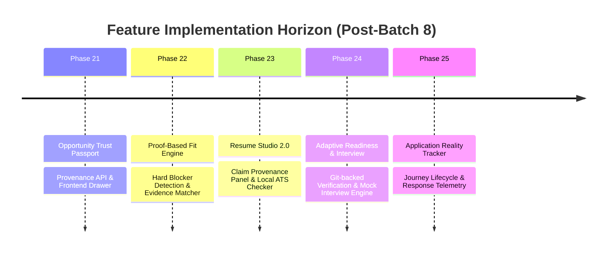

# RoleRadar — Product Strategy & Feature Roadmap
## The Opportunity-to-Readiness Engine

**Document ID:** `RR-DOC-2026-PROD-V1`  
**Effective Date:** November 7, 2026  
**Status:** `STATUS: SAFE TO SHARE` / Approved Product Blueprint  
**Governance Authority:** Aligned with `docs/PROJECT_RULES.md` and `docs/ENGINEERING_STANDARDS.md`  
**Target Architecture:** Node.js 20+ / Express / TypeScript Backend, PostgreSQL 16 / Drizzle ORM, React 19 / Vite / Tailwind v4 Frontend

---

## 1. Executive Mandate & Strategic Pivot

### 1.1 Freeze on Employer Scraping Expansion
As of November 7, 2026, RoleRadar has officially stopped expansion of employer scrapers/adapters. 
* **Ingestion Milestone Complete:** Ingestion coverage achieved across Workday Batches 1 through 8 (including Adobe, Qualcomm, Schneider Electric, Airbus, NVIDIA, Santander, LEGO, Humana, GoTo, Sysco, Teleperformance, Salesforce, Workday, and Teladoc Health).
* **Direct ATS Provenance:** All active postings are derived directly from verified employer Applicant Tracking Systems with zero third-party aggregator pollution, strict URL provenance checks, and complete absence reconciliation.
* **The Pivot:** Ongoing development shifts entirely from scraping infrastructure to **building differentiated candidate-facing product features**. Additional employer batches are strictly deferred until core candidate features reach production readiness.

### 1.2 Core Mission: From "Job Search" to "Job Readiness"
RoleRadar rejects the commoditized paradigm of generic job boards and AI resume spammers. 
RoleRadar is defined as an **Opportunity-to-Readiness Engine** that transitions a candidate from:
> *"I need a job and will blast 100 auto-generated resumes"*  
to  
> *"I am targeting a verified, active requisition, have provable evidence for its requirements, understand my gaps, and am prepared to pass selection."*

---

## 2. Market Problem Analysis & Global Evidence

| Market Failure | Empirical Research Evidence | How RoleRadar Solves It |
| :--- | :--- | :--- |
| **Ghost & Fake Postings** | U.S. Congressional Research Service details ghost postings as advertised roles not intended for immediate hire. Huntr (2026 survey, 559 respondents) found 93% encountered suspected ghost postings; 72% encountered job scams. | Direct ATS ingestion only. Jobs verified against official employer domains with automated absence reconciliation (`isCompleteScan`) closing unlisted requisitions. |
| **Employer Ghosting & Silence** | Stepstone Group (2025 survey, 8,100 job seekers) found 64% were ghosted by employers. Indeed India (2026) reported 29% cited silence post-application as their #1 frustration. | An Application Reality Tracker that transparently separates candidate-confirmed actions from verified source events (e.g. listing closed vs candidate rejected). |
| **Fresher Experience Gap** | Cengage Graduate Report (2025) found only 30% of graduates secured field roles; 48% felt unprepared for entry-level positions, with 56% citing job-specific skill gaps as the barrier. Mercer \| Mettl (2025) showed 42.6% employability among assessed Indian graduates. | Factual, deterministic fresher gap identification. Recommends tangible portfolio projects and code proof instead of encouraging resume inflation. |
| **Superficial Trust Badges** | LinkedIn Help documentation notes that job verification badges confirm poster identity but do not indicate fit or enhance hiring chances. | Multi-dimensional **Opportunity Trust Passport** exposing 5 verifiable dimensions (requisition ID, careers domain check, freshness date, lifecycle state, compensation transparency). |
| **Credential vs. Skill Proxy** | OECD research notes degrees and tenure remain imperfect proxies for capability, while skills-first hiring accelerates. | **Career Evidence Graph** linking candidate claims to verifiable projects, code repositories, coursework, and validated assessments. |

---

## 3. Competitive Landscape & Defensible Differentiation

| Competitor | Established Market Position | RoleRadar Strategic Differentiation |
| :--- | :--- | :--- |
| **LinkedIn** | Massive discovery network, verified profiles, basic job badges. | Inspectable requisition provenance and detailed requirement evidence rather than simple poster checkmarks. |
| **Simplify** | Autofill, application tracking, job recommendations. | Avoid low-signal mass applications; prioritize high-evidence matching and truth-preserving tailoring. |
| **Teal** | Job tracking, keyword highlighting, AI resume assistance. | Tie every resume bullet to an underlying immutable **Career Evidence Profile** to eliminate AI hallucination. |
| **Huntr** | Base and tailored resumes, Kanban tracking board. | Maintain a unified relational evidence graph rather than unlinked text variants. |
| **Jobscan** | ATS keyword density and comparison percentages. | Replace arbitrary percentage match scores with deterministic, inspectable criteria (Hard Blockers vs. Learnable Gaps). |

---

## 4. The 5 Core Connected Engines

RoleRadar operates as a unified intelligence system sharing a single underlying data model. Candidate profiles, verified requisitions, skill evidence, resume bullets, and preparation milestones share identical canonical definitions.

### Engine 1: Opportunity Trust Passport
* **Purpose:** Present an inspectable, transparent record of why a job posting is authentic.
* **Core Dimensions:**
  1. *Employer & Careers Domain Verification:* Confirms HTTPS origin matches `companies.official_domain` (no aggregators or redirect hops).
  2. *Requisition Identity:* Canonical ATS requisition ID (e.g. `R-102118`, `26WD100698`).
  3. *Upstream Freshness & Absence State:* Timestamp of the last complete sync (`isCompleteScan = true`) and current lifecycle state (`ACTIVE`, `VERIFYING`, `CLOSED`).
  4. *Compensation Provenance:* Disclosed by employer vs unstated (never synthetic estimates).
  5. *Verification Audit Log:* Append-only history from `job_verifications`.

### Engine 2: Proof-Based Job Fit Engine
* **Purpose:** Deterministic, explainable candidate-job alignment without arbitrary percentages or AI hallucination.
* **Core Invariants:**
  * Categorizes requirements into **Hard Eligibility Blockers** (e.g. required 5+ years experience when candidate is fresher) vs **Learnable Skill Gaps** (e.g. missing Spring Boot).
  * Evaluates skills against canonical taxonomy mapping (`backend/src/matching/canonical-taxonomy.ts`).
  * Never marks a candidate "unqualified"; uses factual language: *"Requirement not demonstrated in current profile"*.
  * Zero tolerance for unearned skill claims.

### Engine 3: Career Evidence Profile & Truth-Preserving Resume Studio
* **Purpose:** Single source of truth for professional capability and JD-specific tailoring.
* **Core Principles:**
  * **Master Career Evidence Profile:** Contains education, employment, projects, certifications, and skills. Every claim carries an evidence source (`SELF_REPORTED`, `REPO_VERIFIED`, `ASSESSMENT_VERIFIED`).
  * **Claim Provenance Panel:** Clicking any bullet in a tailored resume highlights the exact project or experience record in the database supporting that statement.
  * **Deterministic ATS Parsing Inspection:** Renders an unstyled machine-text extraction preview via `pdf-parse`/`mammoth` to check character density, contact parsing, and heading hierarchy without false scoring promises.
  * **Gap-to-Project Recommendations:** For missing technical requirements, suggests concrete projects to build and link before claiming the skill.

### Engine 4: Adaptive Career Readiness & Interview Studio
* **Purpose:** Practical, role-specific capability building and selection simulation.
* **Core Principles:**
  * **Git-Backed Skill Proof:** Candidates submit public GitHub/GitLab repositories for project claims; system validates commit history and test suites to upgrade evidence to `REPO_VERIFIED`.
  * **Job-Specific Interview Simulator:** Simulates technical and behavioral interviews grounded strictly in the target job's requirements and candidate's claimed projects.
  * **Four-Part Rubric Feedback:** Scores sessions on *Technical Accuracy*, *Structured Problem Solving*, *Ownership & Depth*, and *Communication Clarity*.
  * **Multi-Round Selection Practice:** Prepares candidates for coding, SQL, case scenarios, and HR rounds.

### Engine 5: Application Reality & Response Intelligence
* **Purpose:** Transparent tracking of the application journey with verified telemetry.
* **Core Principles:**
  * **Separation of Facts from Inference:** Distinguishes user-confirmed events (Application Submitted, Assessment Scheduled) from platform-verified events (Job Listing Closed upstream). Employer silence is never labeled as rejection.
  * **Cohort Response Telemetry:** Aggregates anonymized, consented time-to-first-response data by role and region once sample thresholds ($N \ge 30$) are satisfied.

---

## 5. Relational Data Model (PostgreSQL & Drizzle ORM)

The platform architecture extends `backend/src/database/schema.ts` to support the evidence-claim graph:

### Table Specifications:
1. `candidate_evidence`:
   * `id` (UUID PK), `user_id` (FK users.id), `evidence_type` (`PROJECT`, `EXPERIENCE`, `EDUCATION`, `CERTIFICATION`).
   * `reference_id` (UUID to referenced entity), `claim_text` (TEXT), `verification_tier` (`SELF_REPORTED`, `REPO_VERIFIED`, `ASSESSMENT_VERIFIED`).
2. `resume_bullets`:
   * `id` (UUID PK), `resume_id` (FK resumes.id), `evidence_id` (FK candidate_evidence.id nullable).
   * `bullet_text` (TEXT), `provenance_status` (`BACKED`, `UNLINKED`).
3. `job_readiness_plans`:
   * `id` (UUID PK), `user_id` (FK users.id), `job_id` (FK jobs.id), `gap_skills` (JSONB), `target_milestones` (JSONB), `status` (`ACTIVE`, `COMPLETED`).
4. `application_journey_events`:
   * `id` (UUID PK), `user_id` (FK users.id), `job_id` (FK jobs.id), `event_type` (`SUBMITTED`, `ASSESSMENT_INVITE`, `INTERVIEW_ROUND`, `OFFER`, `SOURCE_CLOSED`), `source` (`USER_CONFIRMED`, `PLATFORM_VERIFIED`).

---

## 6. What RoleRadar Deliberately Avoids

To preserve candidate trust and technical integrity, the following anti-patterns are strictly prohibited:

| Prohibited Anti-Pattern | Architectural Rationale |
| :--- | :--- |
| **Generic Chatbot as Main Interface** | Low barrier to entry, easily copied, clutters workflow, prone to hallucination. |
| **One-Click Mass Autofill Spam** | Floods employer ATS with low-signal applications, leading to domain blocks and user bans. |
| **Fabricated Resume Content** | Generative AI must never invent employers, metrics, or technologies not present in the master profile. |
| **Opaque ATS Pass Percentages** | ATS systems do not expose proprietary parsing algorithms; claiming "94% ATS Pass Rate" is deceptive. |
| **Guaranteed Hiring Claims** | Outcomes depend on hiring managers and market factors; RoleRadar guarantees preparation, not offers. |
| **Inferred Rejections from Silence** | Employer delays or unannounced freezes must never be labeled as candidate rejection without proof. |
| **Aggregator & Scraper Feeds** | Strictly 0 jobs admitted from aggregators (Indeed, LinkedIn, Naukri). |

---

## 7. Phased Implementation Roadmap

### Phase 21: Opportunity Trust Passport
* **Target Delivery:** Immediate Next Sprint
* **Backend:** `/api/jobs/:id/trust-passport` exposing requisition ID, careers domain check, freshness date, and append-only verification events.
* **Frontend:** Interactive Trust Drawer on Job Details view rendering 5 verifiable dimensions.
* **Exit Gate:** 100% test coverage asserting direct ATS link integrity and provenance checks.

### Phase 22: Proof-Based Fit Engine
* **Target Delivery:** Follow-up Sprint
* **Backend:** Upgrade `backend/src/resume/job-fit-evaluator.ts` into a Tiered Evidence Evaluator distinguishing blockers from learnable skills.
* **Frontend:** Explainable Fit UI showing Supported Skills, Missing Requirements, and Fresher Feasibility.
* **Exit Gate:** Automated regression tests validating 0 unearned skills and deterministic scoring.

### Phase 23: Career Evidence Profile & Resume Studio 2.0
* **Target Delivery:** Core Studio Milestone
* **Backend:** Drizzle schema migration for `candidate_evidence` and `resume_bullets`. PDF/DOCX local text extraction endpoint.
* **Frontend:** Side-by-side Resume Studio with interactive Claim Provenance inspector and unstyled ATS parser preview.
* **Exit Gate:** Hermetic tests verifying bullet-to-evidence graph traversal and zero unsupported bullet generation.

### Phase 24: Adaptive Preparation Plan & Interview Studio
* **Target Delivery:** Readiness Milestone
* **Backend:** Adaptive learning path generator, GitHub repository verifier, and mock interview state machine.
* **Frontend:** Interactive Preparation Dashboard and Rubric-Based Mock Interview session with speech/text support.
* **Exit Gate:** Real runtime simulation testing verifying rubric consistency and repository inspection reliability.

### Phase 25: Application Reality Tracker & Outcome Telemetry
* **Target Delivery:** Telemetry Milestone
* **Backend:** Application journey event logging with concurrency safeguards and anonymized aggregation pipeline.
* **Frontend:** Application timeline view showing user-confirmed milestones side-by-side with verified job status.
* **Exit Gate:** Concurrency integration tests confirming zero duplicate events and strict anonymization filters ($N \ge 30$).

---

## 8. Governance & Conflict Resolution Protocol

When future design decisions, pull requests, or architectural proposals conflict:
1. **Precedence Hierarchy:**
   $$\text{ENGINEERING\_STANDARDS.md} \ge \text{PRODUCT\_STRATEGY\_AND\_FEATURE\_ROADMAP.md} > \text{Ad-Hoc Requests}$$
2. **The Authenticity Rule:** If a feature requires sacrificing source provenance, inventing synthetic data, or facilitating unverified claims, it is **strictly rejected**.
3. **Maturity Classifications:** All deliverables across Phase 21–25 must satisfy the standard maturity classifications (`IMPLEMENTED`, `TESTED`, `VERIFIED`, `PRODUCTION-READY`) with empirical proof prior to merge.

